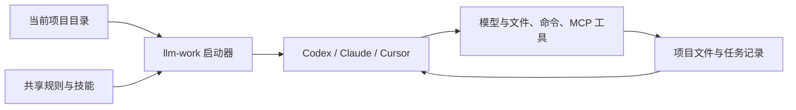

# LLM Work：跨终端 AI 工具的工作与学习流程

在 Codex CLI、Claude Code 和 Cursor Agent CLI 之间复用工作规则、技能和项目任务记录。进入项目文件夹，运行 `llm-work`，即可先了解目录、再安排工作；工具可以切换，项目进度保留在文件里。

项目起源于 Codex 工作方法调研，目标是提高复杂任务的思考、执行、验证和完成质量，支持跨会话恢复、科研与学习。Token 消耗不作为筛选标准。

## 项目组成

| 目录 | 职责 |
| --- | --- |
| `docs/` | 工作方法、技能与 MCP 调研、社区证据和效果评估方案 |
| `baseline/` | 普通 Codex 的 9 个精选 skills、个人约定、Context7 / DeepWiki / Playwright 配置、备份与回退 |
| `workflow/` | 共享核心规则、5 个工作流 skills、CLI 适配、依赖锁定、部署与检查 |
| `bin/llm-work` | 统一日常入口，默认当前目录，记住所选 CLI |
| `bin/codex-work` | 兼容旧命令，始终使用 Codex |
| `tests/` | 不依赖个人配置或网络的安装、更新、回退和启动器测试 |
| `learning/` | 学习入口说明；实际课程与个人记录不进入此仓库 |

每个项目文件夹就是一个工作目录；未指定目录时使用启动命令时所在的文件夹。Codex 通过 profile 和技能链接接入；Claude Code / Cursor Agent 通过会话级本地插件接入。安装后需要保留克隆目录，机器路径由安装器解析。

## 日常使用

```bash
cd /path/to/project
llm-work
```

启动后会自动只读查看当前目录：空目录提示你安排新任务；已有项目先读取说明、进展与交接材料，结合当前文件给出背景摘要和下一步选择。这个阶段不创建任务记录或课程，也不自动执行旧待办。接着直接说明要做的事即可。

选择常用工具一次，之后继续用 `llm-work`：

```bash
llm-work use claude     # 或 codex、cursor
llm-work               # 在当前项目开始
```

临时切换用 `llm-work --harness cursor`，不改变默认选择。`llm-work continue` 读取当前项目 `.workstyle/tasks/` 接续工作；`llm-work resume` 恢复所选 CLI 自己的原对话。指定目录用 `llm-work -C /path/to/project`。启动规则集中维护在 [项目交接指令](workflow/startup.md)。

## 工作原理

`llm-work` 是一个 Python 启动器。它读取你保存的工具选择，确定当前项目目录，把规则、技能和请求交给对应 CLI，随后由该 CLI 接管终端。模型调用、登录、工具执行和权限审批都由所选 CLI 处理。



启动器会发送“先只读了解项目”的指令，由 AI 检查目录并判断：空目录等待新任务，已有项目先总结背景、进度和接手点。收到具体请求后，再按共享规则完成调查、实现与验证。核心规则在 [core.md](workflow/core.md)，技能按任务需要读取，默认安装 5 个工作流技能和 9 个精选技能。

三种 CLI 的加载接口不同：Codex 使用独立 profile；Claude 追加系统指令并加载本地插件；Cursor 加载插件，并在新会话首条请求中明确带上规则。CLI 的接入差异集中在 [启动器](workflow/launcher.py) 与 [适配安装器](workflow/adapter_install.py)。

多步骤工作的目标、决定、证据和下一步写在目标项目 `.workstyle/tasks/`。切换工具后，`continue` 让新会话阅读这些文件恢复进度；`resume` 使用当前工具自己的历史。只有已保存到项目文件的内容能够以这种方式交接，配置仓库本身不会替你同步各个项目。

MCP 为 CLI 提供额外工具，例如 DeepWiki 的仓库资料和 Playwright 的浏览器操作。新机器克隆此仓库并运行安装器后，会按该机器的路径生成配置；账号、模型选择和项目材料由各自的 CLI 与项目管理。

## 新机器部署

在准备好 Python、Node.js 和所选 CLI 的 Linux / WSL2 环境中：

```bash
git clone https://github.com/Aunity/llm-work.git llm-work
cd llm-work
python3 workflow/bootstrap.py --harness claude
export PATH="$HOME/.local/bin:$PATH"
llm-work -C /path/to/project
```

`--harness` 可选 `codex`、`claude`、`cursor`、`all`；省略时保持原来的 Codex 安装方式。只安装所选工具的适配，不要求机器上同时装三种 CLI。版本与适配边界见 [CLI 接入说明](workflow/HARNESSES.md)，部署、更新与回退见 [快速开始](QUICKSTART.md)。登录和模型配置由各 CLI 自己管理。

## 持续迭代

```bash
python3 -m unittest discover -s tests -v
git diff --check
```

用功能分支修改，检查通过后提交；其他机器拉取同一版本后运行 `python3 workflow/bootstrap.py --harness claude --update`（替换为所用 CLI）。详细约定见 [维护指南](CONTRIBUTING.md)，第三方内容见 [来源与许可证](THIRD_PARTY_NOTICES.md)。

本次 Linux 上的全新克隆部署、自动化测试和真实 MCP 操作结果见 [验收记录](workflow/VALIDATION.md)，其中注明实际验证与未验证范围。

## 背景材料

以下调研的资料核对日期为 **2026 年 11 月 16 日**，保留为当时的研究和安装记录；当前部署方式以快速开始为准。

- [Codex 使用方法与任务完成质量](docs/codex-workflow.md)：任务模板、执行方法与质量标准。
- [Skills 与 MCP 候选全景](docs/skills-mcp-landscape.md)：13 组技能或工作流、22 项 MCP 候选及适用边界。
- [社区实践与技术分享](docs/community-evidence.md)：第一手来源、不同反馈和证据局限。
- [试用与效果评估](docs/evaluation-plan.md)：通过真实任务比较配置的实际收益。
- [普通 Codex 首批安装记录](docs/codex-cli-baseline.md)：9 个技能的选择依据及原机器验收。

候选清单不等于安装清单。程序可运行、MCP 可连接和任务质量提高需要分别验证；当前不宣称完成了技能收益的对照实验。
